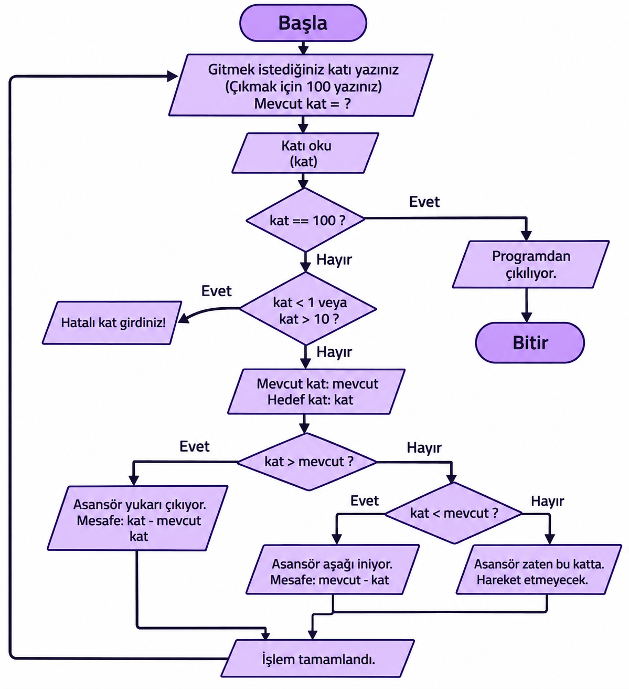

# 🛗 ASANSÖR KARAR ALGORİTMASI

  
  
  

---

## 👤 Öğrenci Bilgileri

| **rüzgar v.** | |
| **0052** | |
| **ethosoft** | Bilgisayar Bilimi |
| **Proje** | Asansör Karar Algoritması |

---

## 1. 📌 Problemin Açıklaması

Bu projede 10 katlı bir binadaki asansörün hangi yöne gideceğini bulmaya çalıştım. (bulmak istemedim ödev olduğu için)

Kullanıcı gitmek istediği katı yazıyor. Asansör de bulunduğu kata göre yukarı veya aşağı hareket ediyor.(keşke etmese.)

Eğer kullanıcı yanlış bir kat yazarsa hata mesajı veriyor.

## 2. ⚙️ Girdi - İşlem - Çıktı

### 📥 Girdiler
- Kullanıcının gitmek istediği kat.
- Asansörün mevcut katı.
- Programdan çıkmak için 100 sayısı.

### 🔄 İşlemler
- Önce kullanıcının girdiği sayıyı kontrol ederiz.
- Girilen sayı 100 ise program kapanır.
- Sayı 1 ile 10 arasında değilse hata mesajı verir.
- Hedef kat mevcut kattan büyükse yukarı çıkar.
- Hedef kat mevcut kattan küçükse aşağı iner.
- İki kat aynıysa hareket etmez.
- Gidilecek kat sayısını hesaplar.
- Yeni mevcut katı hedef kat olarak değiştirir.

### 📤 Çıktılar
- Mevcut kat.
- Hedef kat.
- Asansörün gideceği yön.
- Kaç kat gideceği.
- Hata veya işlem tamamlandı mesajı.

---

## 3. 💻 Sözde Kod (Pseudocode)

1. Başla.
2. Mevcut katı 1 olarak belirle.
3. Kullanıcıdan gitmek istediği katı iste.
4. Eğer kullanıcı 100 yazarsa programı bitir.
5. Girilen kat 1 ile 10 arasında değilse hata mesajı yaz.
6. Eğer hedef kat mevcut kattan büyükse yukarı çık.
7. Eğer hedef kat mevcut kattan küçükse aşağı in.
8. Eğer hedef kat mevcut kata eşitse hareket etme.
9. Kaç kat gidileceğini hesapla.
10. Mevcut katı yeni hedef kat olarak değiştir.
11. Tekrar 3. adıma dön.
12. Bitir.

---

## 4. 🔀 Akış Şeması

Aşağıdaki akış şeması programın nasıl çalıştığını göstermektedir.

---

## 5. 🧪 Test Sonuçları

Aşağıdaki testlerde her senaryonun başlangıç katı ayrı ayrı ayarlanarak kontrol edilmesi amaçlanmıştır.

| Mevcut Kat | Hedef Kat | Beklenen Sonuç | Programın Sonucu | Doğru mu? |
|:---:|:---:|:---|:---|:---:|
| 3 | 8 | 5 kat yukarı | 5 kat yukarı | ✅ |
| 9 | 2 | 7 kat aşağı | 7 kat aşağı | ✅ |
| 5 | 5 | Hareket yok | Hareket yok | ✅ |
| 1 | 10 | 9 kat yukarı | 9 kat yukarı | ✅ |
| 10 | 1 | 9 kat aşağı | 9 kat aşağı | ✅ |
| 0 | 5 | Geçersiz mevcut kat | Hata mesajı | ✅ |
| 5 | 11 | Geçersiz hedef kat | Hata mesajı | ✅ |
| -2 | 4 | Geçersiz mevcut kat | Hata mesajı | ✅ |
